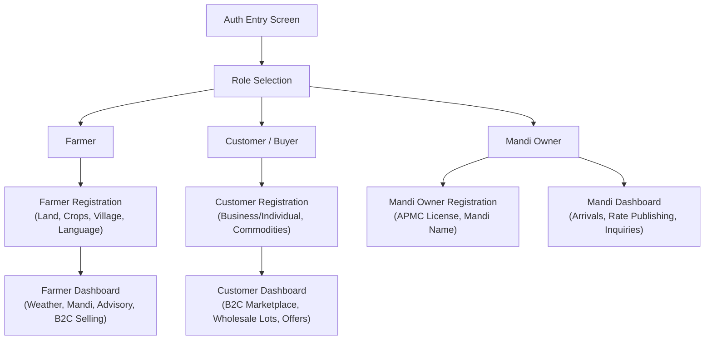
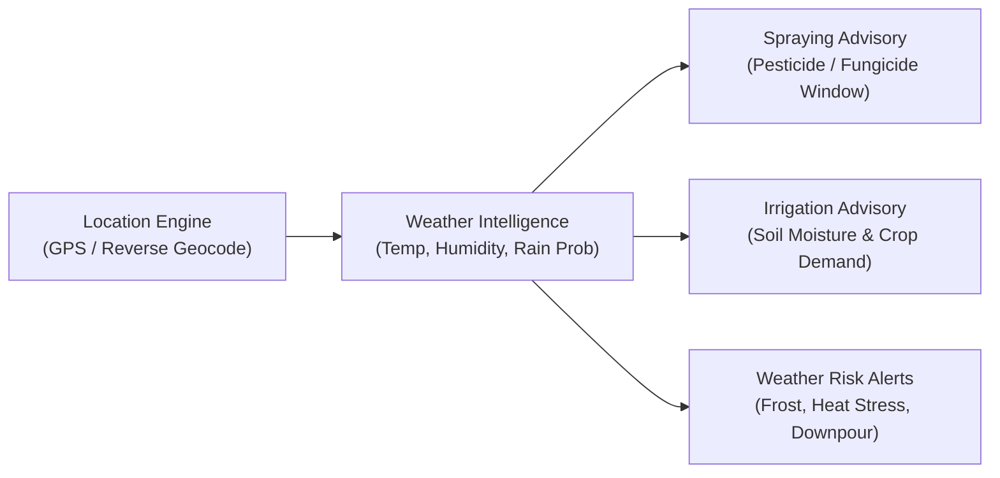
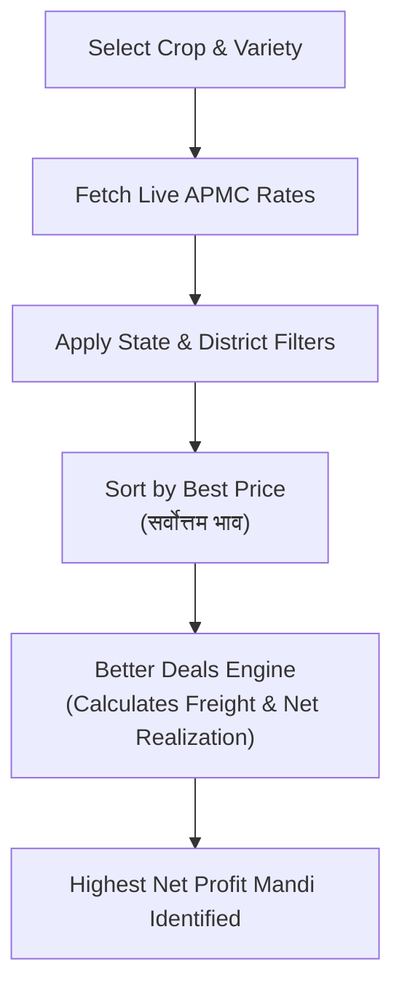
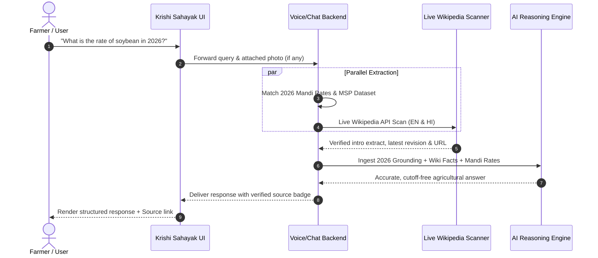
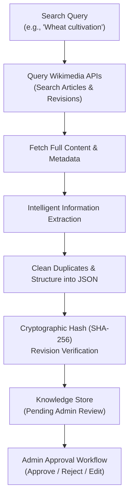
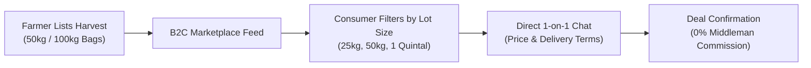
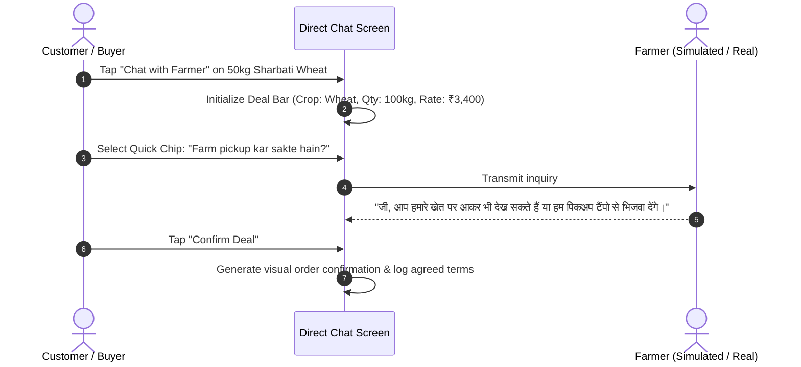

# KisanSAATHI (Your Digital Krishi Officer)
## Comprehensive Project Documentation: Architecture, Features & Implementation Guide

---

## 1. Executive Summary & Platform Purpose

**KisanSAATHI** is a unified digital agricultural operating system built to empower the agricultural value chain in India. The platform bridges the gap between traditional agricultural practices, institutional mandi (APMC) trading, and direct-to-consumer (B2C) commerce.

The system addresses three critical challenges in the agricultural ecosystem:
1. **Information Asymmetry:** Farmers often lack real-time local weather-risk advisories, verified agronomic best practices, and real-time mandi prices across competing markets.
2. **Intermediary Exploitation & Commission Losses:** Traditional supply chains subject farmers to steep mandi cuts, commission charges, and grading discounts when selling entire harvests to intermediaries.
3. **Absence of Direct Retail Channels:** Retail consumers, families, and local businesses struggle to purchase fresh, unadulterated staple grains, pulses, and oilseeds directly from verified farms in household-friendly quantities (such as 50 kg or 1 quintal).

To solve these problems, KisanSAATHI unites **Farmers**, **Retail Customers / Bulk Buyers**, and **Mandi Owners** within an intelligent, role-governed platform featuring real-time market intelligence, an AI agricultural advisory bot with live Wikipedia web scanning, an automated data extraction engine, and a direct B2C marketplace with built-in farmer-customer negotiation chat.

---

## 2. Multi-Role Authentication & Access Control System

The application is structured around a strict role-based access control (RBAC) model. Upon launch, the system identifies the user's role and unlocks a dedicated dashboard, navigation structure, and feature suite.

### Role Architecture

### 1. Farmer Role
- **Purpose:** Daily agricultural decision-making, agronomic advisory, mandi price optimization, and direct produce selling.
- **Dedicated Data:** Full name, mobile number, state, district, village, land size, primary crops, farming experience, and preferred regional language.
- **Accessible Suite:** Smart Farm Advisory, Live Mandi & Better Deals Engine, Krishi Sahayak AI Assistant, and Kisan Direct B2C Selling.

### 2. Customer / Buyer Role
- **Purpose:** Sourcing agricultural commodities either in bulk (wholesale lots) or in retail/household packaging directly from farmers.
- **Dedicated Data:** Buyer name, business name, business type (Trader, Miller, Retail Consumer, Institution), target commodities, and district/state.
- **Accessible Suite:** Kisan Direct B2C Marketplace (50kg/100kg lots), Wholesale Farmer Produce Feed, Purchase Offer Submission Engine, and 1-on-1 Farmer Negotiation Chat.

### 3. Mandi Owner / APMC Trader Role
- **Purpose:** Managing physical market yard operations, posting daily arrival volumes, and broadcasting official auction prices.
- **Dedicated Data:** Mandi name, APMC license number, market yard location, operating commodities, and contact details.
- **Accessible Suite:** Daily Mandi Arrivals Logger, Real-Time Rate Publisher, Weighment & Quality Slip Manager, and Trade Inquiries Inbox.

---

## 3. Core Farmer Dashboard & Agronomic Intelligence

The Farmer experience serves as an everyday digital agronomist, combining hyper-local sensor data with scientific farming guidelines.

### A. Geolocation & Hyper-Local Weather Engine
- **Automatic GPS Detection:** Identifies the farm's exact latitude and longitude with one tap.
- **Reverse Geocoding:** Translates raw coordinates into human-readable Indian administrative divisions (Village, Block, District, and State).
- **Manual District Search Modal:** Enables farmers to look up and monitor weather and prices across any district in India.
- **Weather Telemetry:** Displays ambient temperature, relative humidity, wind speed, precipitation probability, and multi-day hourly forecasts.

### B. Agricultural Advisory Engine
- **Spraying Window Calculation:** Evaluates wind speed and rain probability over the next 24 hours. If rainfall is imminent or wind exceeds safe dispersion thresholds, it alerts the farmer against spraying expensive chemicals.
- **Crop & Soil-Specific Irrigation Planning:** Synthesizes soil texture (Clay, Loam, Sandy) with specific crop profiles (Wheat, Paddy, Mustard, Cotton, Vegetables) to determine whether immediate irrigation is required or can be postponed to conserve water and power.
- **Weather Risk Alerts:** Flags sudden frost hazards, extreme temperature spikes, or untimely harvest-time precipitation.

---

## 4. Live Mandi Intelligence & "Better Deals" Discovery Engine

Rather than displaying static market rates, KisanSAATHI functions as a profit-maximization engine for farmers deciding where to sell their harvest.

### Key Functional Capabilities
1. **Pan-India Mandi Benchmark Database:**
   - Tracks live modal prices, minimum prices, and maximum prices across major agricultural markets in Haryana, Punjab, Madhya Pradesh, Rajasthan, Uttar Pradesh, Maharashtra, and Gujarat.
   - Categorized by Cereals, Pulses, Oilseeds, Vegetables, Fruits, and Cash Crops.
2. **"Best Price" (सर्वोत्तम भाव) Primary Sorting:**
   - Automatically ranks competing mandis by the highest prevailing price per quintal.
3. **State Dropdown with Search & Quick Filter Chips:**
   - Allows farmers to toggle between nationwide mandis or restrict views to their home state or neighboring borders.
4. **"Better Deals" Freight & Net Profit Calculator:**
   - Computes distance from the farmer's current coordinates to each APMC mandi.
   - Calculates estimated vehicle transport and diesel costs per quintal.
   - Compares the higher price offered at distant mandis against local mandi rates minus transport expenses to reveal true net profit.
5. **2026 Real-Time Benchmark Rates Integration:**
   - Embeds updated 2026 Minimum Support Prices (MSP) and APMC modal averages (e.g., Soybean 2026 MSP ₹4,892/quintal, Modal ₹5,120/quintal; Wheat MSP ₹2,425/quintal; Mustard MSP ₹5,650/quintal).

---

## 5. Krishi Sahayak: AI Agricultural Assistant with Live Wikipedia Web Scanner

**Krishi Sahayak** acts as a 24/7 personal Krishi Officer, capable of answering complex farming questions via text or voice.

### Key Technical & Architectural Features
- **Temporal Grounding (Year 2026):** Systematically eliminates outdated 2023 knowledge cutoff claims, providing up-to-date 2026 market benchmarks and agricultural policies.
- **Dynamic Live Wikipedia Web Scanner:**
  - Extracts keywords from the farmer's query in real-time.
  - Interrogates official Wikimedia Action APIs across English (`en.wikipedia.org`) and Hindi (`hi.wikipedia.org`).
  - Extracts clean, unformatted article introductions and revision metadata without requiring API keys.
  - Dynamically injects verified encyclopedic facts into the model's reasoning prompt.
  - Automatically caches the scanned article into the local verified knowledge store for persistent offline reuse.
- **Transparent Source Attribution Badge:**
  - Every message enriched by live web scans renders a dedicated attribution banner: `Source: Wikipedia (<Article Title>)`.
- **Multimodal Image Diagnosis:**
  - Farmers can photograph diseased leaves or infected crops; the assistant inspects symptoms and suggests remedial steps.

---

## 6. Automated Wikipedia Agricultural Data Scraping Bot (Admin Suite)

An internal administration and knowledge-harvesting system built directly into the application.

### System Capabilities
- **Targeted Category Pipeline:** Extracts records across Crop Information, Crop Diseases, Soil Information, Farming Techniques, Agricultural Pests, and General Plant Science.
- **Revision Tracking & Cryptographic Hashing:** Every extracted record computes a SHA-256 hash across content and revision ID to detect upstream Wikipedia edits.
- **Admin Verification Panel:** Allows administrators to filter records by status (Pending, Approved, Rejected), language, and category, and edit summaries before releasing them into the assistant's knowledge base.

---

## 7. Kisan Direct: Direct Farmer-to-Consumer (B2C) Marketplace

The newly integrated **B2C Platform** creates a direct bridge between local farmers and household consumers, restaurants, and small retail establishments.

### 1. Consumer-Tailored Packaging & Quantities
Unlike wholesale mandis that mandate truckloads or 50–100 quintal minimums, Kisan Direct specializes in retail-friendly packaging:
- **25 kg Bag:** Trial household pack or specialty organic grain.
- **50 kg Bag:** Standard household consumption sack (wheat, rice, pulses).
- **100 kg (1 Quintal):** Large family, joint household, or local grocery purchase.

### 2. Dual Transparent Pricing
Every listing displays both unit price and bag price:
- Price per Kilogram (e.g., `₹34/kg`)
- Price per 50 kg Bag (e.g., `₹1,700`)
- Price per 1 Quintal / 100 kg (e.g., `₹3,400`)

### 3. Package Size & Category Filters
- Quick filter tabs: `All Lots`, `50 kg Bags`, `100 kg (1 Quintal)`, and `25 kg Trial`.
- Produce categories: Wheat, Rice, Mustard Oil & Seeds, Soybean & Pulses, Organic Jaggery, Garlic & Onion.

### 4. "List Harvest" Farmer Publishing Engine
Farmers can list their produce in under 60 seconds with:
- Crop name and variety.
- Rate per kg, rate per 50kg, and rate per quintal.
- Total available quantity in quintals.
- Farm village, district, and distance radius.
- Delivery options: Farm Gate Pickup or Doorstep Delivery within a specified kilometer radius.

---

## 8. Farmer-Customer Direct Negotiation Chat System

To facilitate direct transactions without middleman friction, KisanSAATHI incorporates a dedicated 1-on-1 chat and negotiation system.

### Chat Interface Features
1. **Sticky Deal Context Bar:**
   - Remains anchored at the top of the chat, displaying the crop name, requested quantity (e.g., `50 kg Bag` or `1 Quintal`), quoted price, and deal status (`Active`, `Confirmed`).
2. **Farmer Identity & Status Bar:**
   - Displays the farmer's name, village location, distance in kilometers, live online status indicator, and a direct telephone trigger.
3. **One-Tap Quick Negotiation Action Chips:**
   - *"50 kg available hai kya?"*
   - *"Farm pickup kar sakte hain?"*
   - *"Bhav thoda kam ho sakta hai (Negotiate)?"*
   - *"1 Quintal ka final rate?"*
   - *"Sample photo bhejenge?"*
4. **Realistic Farmer Dialogue Simulation:**
   - Features an intelligent, context-aware reply generator that responds in natural Hindi or English based on the buyer's inquiry (rate discussions, quality questions, delivery arrangements, or package availability).
5. **Interactive "Confirm Deal" Agreement Modal:**
   - Summarizes crop, package quantity, total payable amount, and farm pickup address, sealing the transaction directly between the parties without platform deductions.
6. **Unified Negotiation Inbox (`B2CChatsList`):**
   - Keeps track of all open and completed chats with timestamp previews and deal badges.

---

## 9. Customer (Buyer) & Mandi Owner Workflows

### Customer / Wholesale Buyer Workflow
- **Produce Procurement Feed:** Displays large-scale farmer listings with certified moisture grades, harvest dates, and warehouse locations.
- **Formal Purchase Offer Submission:** Buyers can bid specific prices per quintal, specify payment timelines (e.g., Bank Transfer within 24 hours of weighment), and choose delivery conditions (e.g., Mill Gate vs. Farm Gate).
- **Offer Status Tracking:** Tracks whether submitted bids are Pending, Accepted, or Countered by the farmer.

### Mandi Owner / APMC Trader Workflow
- **Arrival Logging:** Tracks truckload arrivals by crop, moisture level, vehicle registration number, and source district.
- **Price Board Broadcasting:** Publishes minimum, modal, and maximum auction rates for the day.
- **Inquiry Handling:** Reviews buyer purchase requirements and routes them to registered commission agents.

---

## 10. Design Philosophy & User Experience Standards

- **Zero Artificial Emojis:** Following clean design principles, all fake emojis have been replaced with vector icons (`MaterialCommunityIcons`), high-contrast typography, and official agricultural emblems.
- **Multilingual Support:** Fully operational in **Hindi** and **English**, with terminology tailored to rural Indian agricultural discourse.
- **Rural Network Resilience:** Local caching ensures that previously viewed weather data, mandi rates, and produce listings remain accessible even during network drops.
- **High-Contrast Agricultural Palette:** Deep forest green (`#1B5E20`), golden harvest amber (`#FFD54F`), and clean card containers ensure legibility in bright outdoor sunlight.

---

## 11. Summary of Completed Deliverables

| Module Name | Core Features Built | Primary User Benefit |
| :--- | :--- | :--- |
| **Multi-Role Authentication** | 3-Role selector (Farmer, Buyer, Mandi Owner), specialized registration, automatic role routing. | Each user sees only their relevant tools and workflows. |
| **Smart Weather & Farm Advisory** | Auto GPS detection, reverse geocoding, spraying safety window, crop/soil irrigation calculator. | Reduces chemical waste and prevents weather-induced crop damage. |
| **Live Mandi Intelligence** | Pan-India APMC rates, "Best Price" sorting, distance & freight deduction calculator, 2026 benchmarks. | Empowers farmers to choose the most profitable market yard. |
| **Krishi Sahayak AI Bot** | 2026 temporal grounding, multimodal diagnosis, voice mode, live Wikipedia web scanner. | Immediate, verified answers to farming queries with zero cutoff disclaimers. |
| **Wikipedia Scraping Engine** | Admin bot, MediaWiki API integration, SHA-256 deduplication, admin review pipeline. | Continuously enriches the local agricultural knowledge base. |
| **Kisan Direct (B2C)** | 25kg / 50kg / 100kg lots, dual ₹/kg and ₹/bag pricing, size filters, "+ List Harvest" modal. | Farmers earn 25–40% higher margins by selling directly to consumers. |
| **1-on-1 Negotiation Chat** | Sticky deal bar, one-tap negotiation chips, simulated farmer replies, "Confirm Deal" modal. | Direct, transparent deal closure between farmers and consumers. |
