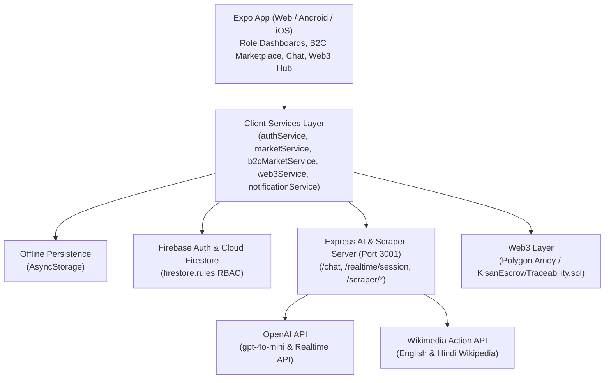

# KisanSAATHI — Your Digital Krishi Officer

**KisanSAATHI** is a full-stack agricultural platform built with React Native (Expo), Express, Firebase, OpenAI, Wikimedia APIs, and Solidity/Web3. It empowers **Farmers**, **Retail Consumers & Bulk Buyers**, and **APMC Mandi Owners** with hyper-local weather advisories, 2026 mandi price discovery, an AI assistant with live Wikipedia web scanning, a direct B2C marketplace (`25 kg`, `50 kg`, `100 kg / 1 Quintal` lots) with 1-on-1 negotiation chat, and Web3 crop provenance with smart contract escrow.

---

## Table of Contents
1. [Architecture Overview](#architecture-overview)
2. [Key Features](#key-features)
3. [Project Structure](#project-structure)
4. [Prerequisites](#prerequisites)
5. [Detailed Setup & Installation](#detailed-setup--installation)
6. [Environment Variables Reference](#environment-variables-reference)
7. [Running the Application](#running-the-application)
8. [Backend API Reference](#backend-api-reference)
9. [Web3 Smart Contract & Provenance](#web3-smart-contract--provenance)
10. [SDLC, Testing & CI/CD](#sdlc-testing--cicd)
11. [Troubleshooting](#troubleshooting)
12. [Documentation & Contributing](#documentation--contributing)

---

## Architecture Overview



---

## Key Features

### 1. Role-Based Access Control (RBAC) & Dashboards
- **Farmer:** Hyper-local weather & spraying/irrigation advisories, live mandi rates, Krishi Sahayak AI assistant, direct B2C crop listing, editable Farm Size & Crops profile, and Web3 harvest passports.
- **Customer / Buyer:** Kisan Direct B2C retail marketplace (`25 kg`, `50 kg`, `100 kg / 1 Quintal`), wholesale produce sourcing, formal bid offers, and direct 1-on-1 negotiation chat with farmers.
- **Mandi Owner / APMC Trader:** Daily arrival logging, auction rate publishing, and trade enquiry management.

### 2. Hyper-Local Weather & Agronomic Intelligence
- Browser/device GPS detection and reverse geocoding via OpenStreetMap Nominatim, plus manual district search across India.
- Live weather telemetry powered by Open-Meteo.
- Automated pesticide spraying window alerts, crop/soil irrigation calculations, and weather risk warnings.

### 3. Live Mandi Intelligence & 2026 Benchmarks
- Pan-India APMC rate tracking across cereals, pulses, oilseeds, vegetables, and fruits.
- **"Best Price" (सर्वोत्तम भाव)** primary ranking and **"Better Deals"** freight-deducted net realization calculator.
- Grounded with 2026 MSP and APMC modal benchmarks (including Soybean 2026 MSP ₹4,892/Q and modal ₹5,120/Q).

### 4. Krishi Sahayak AI & Live Wikipedia Web Scanner
- Text, voice (WebRTC Realtime), and photo-based crop disease diagnosis.
- **Live Wikipedia Web Scanner:** Automatically queries English and Hindi Wikipedia Action APIs on every query, extracts verified encyclopedic context, and displays source attribution in chat.
- **2026 Temporal Grounding:** Eliminates outdated knowledge-cutoff disclaimers when answering current crop rate questions.

### 5. Kisan Direct (B2C) & 1-on-1 Farmer-Customer Chat
- Farmers list retail produce in `25 kg`, `50 kg`, and `100 kg (1 Quintal)` packages with transparent `₹/kg`, `₹/50kg`, and `₹/Quintal` pricing.
- Interactive 1-on-1 chat with sticky deal banner, one-tap negotiation chips, simulated farmer replies, and **Confirm Deal** modal with optional Web3 Smart Escrow lock.

### 6. Real-Time Agricultural Notification Center
- Interactive header bell icon with live unread badge (`notificationsService.js`).
- Category filters (`All`, `Mandi`, `Weather`, `Deals`), deep navigation to target screens, and **Mark all read**.

### 7. Web3 Agri-Chain & Smart Contract Escrow
- **Agri-Wallet:** Connects MetaMask / browser EVM wallets (`window.ethereum`) with a deterministic gasless Agri-Wallet fallback on `Polygon Amoy Agri-Chain`.
- **On-Chain Crop Passports:** Mint and inspect immutable harvest provenance batches with transaction hashes, block numbers, and farm-to-fork milestones.
- **Smart Contract Escrow:** Solidity contract (`contracts/KisanEscrowTraceability.sol`) supporting fund locking and delivery-confirmed release (`FUNDED` -> `RELEASED`).

### 8. Automated Wikipedia Data Scraper (Admin)
- Dedicated admin interface (`screens/admin/DataScraperScreen.js`) for querying Wikimedia APIs, structuring agricultural facts via OpenAI JSON extraction, deduplicating with SHA-256 content/revision hashes, and managing admin approvals.

---

## Project Structure

```text
kisan seva/
├── .github/workflows/ci.yml           # GitHub Actions CI pipeline (syntax + unit tests)
├── contracts/
│   └── KisanEscrowTraceability.sol    # Solidity smart contract for provenance & escrow
├── docs/
│   └── SDLC_SPECIFICATION.md          # 6-phase SDLC specification document
├── screens/
│   ├── admin/DataScraperScreen.js     # Admin Wikipedia + OpenAI extraction bot UI
│   ├── auth/                          # AuthEntry, RoleSelect, Login, Register
│   ├── b2c/                           # B2CMarketplace, B2CChatsList, B2CChatDetail
│   ├── customer/                      # CustomerTab, Home, Browse, Offers, History, Profile
│   ├── mandi/                         # MandiOwnerTab, Overview, Prices, Enquiries, History, Profile
│   ├── web3/Web3TraceabilityScreen.js # Web3 wallet, crop passports, and escrow hub
│   ├── ChatScreen.js                  # Krishi Sahayak AI chat & voice mode
│   ├── HomeScreen.js                  # Farmer dashboard, weather, advisory & notifications
│   ├── MarketScreen.js                # Live APMC mandi rates & freight calculator
│   └── ProfileScreen.js               # Farmer profile, editable farm details, 22 languages, Web3 & admin
├── services/
│   ├── AuthContext.js & authService.js
│   ├── b2cMarketService.js            # B2C small-lot listings & 1-on-1 chat persistence
│   ├── marketService.js               # Mandi rates & 2026 crop catalogue
│   ├── notificationService.js         # Agricultural alerts & unread tracking
│   ├── scraperService.js              # Scraper client service
│   └── web3Service.js                 # Agri-Wallet, crop passports & smart escrow
├── tests/
│   └── runTests.js                    # Automated SDLC test suite (node:test)
├── voice-server/
│   ├── data/agricultural_knowledge.json
│   ├── package.json
│   └── server.js                      # Express backend for /chat, /realtime/session & /scraper/*
├── .env.example                       # Environment variables template
├── App.js                             # Role-based root navigation
├── CONTRIBUTING.md                    # Contribution and engineering workflow guide
├── firebase.json & firestore.rules    # Firebase config and Cloud Firestore security rules
├── package.json                       # App dependencies and QA scripts
├── PROJECT_DOCUMENTATION.md           # Functional & architectural documentation (English)
└── PROJECT_DOCUMENTATION.pdf          # Printable PDF project documentation
```

---

## Prerequisites

- **Node.js:** v20.x or v22.x/v24.x (`node -v`)
- **npm:** v10+ (`npm -v`)
- **OpenAI API Key:** Required for `voice-server` AI chat, voice realtime session, and Wikipedia data extraction.
- **Mobile Testing (Optional):** Android Studio / Expo Go or a custom Expo Dev Client (`expo-dev-client`).
- **Firebase CLI (Optional):** Required only if deploying `firestore.rules` or `firestore.indexes.json` to your own Firebase project.

---

## Detailed Setup & Installation

### Step 1: Clone the Repository
```bash
git clone <your-repository-url>
cd "kisan seva"
```

### Step 2: Configure Environment Variables
Copy `.env.example` to `.env` in the root directory:
```bash
cp .env.example .env
```
If running `voice-server` from inside its subfolder, also ensure `voice-server/.env` (or root `.env`) contains your `OPENAI_API_KEY`.

### Step 3: Install Frontend & Backend Dependencies
Install root Expo/React Native dependencies:
```bash
npm install
```
Install backend Express server dependencies:
```bash
cd voice-server
npm install
cd ..
```

### Step 4: Verify Setup with Automated Checks
Before launching the app, run the syntax and unit test suite:
```bash
npm run lint:syntax
npm test
```

---

## Environment Variables Reference

| Variable | Location | Description | Example |
| :--- | :--- | :--- | :--- |
| `PORT` | Backend (`.env`) | Port for Express AI/Scraper server | `3001` |
| `OPENAI_API_KEY` | Backend (`.env`) | OpenAI API key for `/chat`, `/realtime/session`, and `/scraper/extract` | `sk-...` |
| `EXPO_PUBLIC_VOICE_SERVER_URL` | Frontend (`.env`) | Base URL of the backend server (use your LAN IP for physical mobile devices) | `http://localhost:3001` |
| `EXPO_PUBLIC_WEB3_CHAIN_ID` | Frontend (`.env`) | EVM network chain ID (default Polygon Amoy Testnet) | `0x13882` |
| `EXPO_PUBLIC_WEB3_CONTRACT_ADDRESS` | Frontend (`.env`) | Deployed `KisanEscrowTraceability` contract address | `0x0000...` |

---

## Running the Application

You need **two terminals** running concurrently for full AI, scraping, and frontend functionality:

### Terminal 1 — Start the Backend AI & Wikipedia Scraper Server
```bash
node "voice-server/server.js"
```
Expected output:
`KisanSAATHI backend and scraping server listening on http://localhost:3001`

### Terminal 2 — Start the Expo Frontend
- **Run on Web Browser:**
  ```bash
  npx expo start --web
  ```
  Open `http://localhost:8081` in Chrome or Edge.

- **Run on Mobile Device (Expo Dev Client QR Code):**
  ```bash
  npx expo start --dev-client
  ```
  Scan the terminal QR code with your Android Dev Client build on the same Wi-Fi network.

---

## Backend API Reference

All endpoints are served by `voice-server/server.js` (default port `3001`):

| Method | Endpoint | Purpose |
| :--- | :--- | :--- |
| `POST` | `/chat` | Multilingual AI farming assistant with 2026 mandi benchmarks, local knowledge store, and live Wikipedia web scanning. |
| `POST` | `/realtime/session` | Creates an ephemeral OpenAI Realtime WebRTC session token for hands-free voice mode. |
| `GET` | `/scraper/wiki-search` | Searches English or Hindi Wikipedia via MediaWiki Action API (`?query=...&lang=en\|hi`). |
| `GET` | `/scraper/wiki-page` | Retrieves article text, URL, and latest revision metadata (`?pageId=...&lang=en\|hi`). |
| `POST` | `/scraper/extract` | Structures Wikipedia article text into agricultural JSON via OpenAI with SHA-256 revision hashing. |
| `GET` | `/scraper/records` | Lists extracted records with status, category, language, and search filters. |
| `PATCH` | `/scraper/records/:id` | Approves, rejects, or edits extracted records in the knowledge store. |
| `DELETE` | `/scraper/records/:id` | Deletes a record from the knowledge store. |
| `GET` | `/scraper/stats` | Returns dashboard counts across verification statuses, languages, and categories. |

---

## Web3 Smart Contract & Provenance

- **Smart Contract:** `contracts/KisanEscrowTraceability.sol` (Solidity `^0.8.20`, MIT License).
- **Core Contract Functions:**
  - `registerHarvestBatch(batchId, cropName, originDistrict, quantityKg, metadataHash)`
  - `createEscrowDeal(batchId, farmer, quantityKg)` (payable)
  - `releaseEscrow(dealId)`
  - `raiseDispute(dealId)`
- **Client Integration:** `services/web3Service.js` and `screens/web3/Web3TraceabilityScreen.js` allow seamless wallet connection, passport minting, and escrow release with offline-safe persistence.

---

## SDLC, Testing & CI/CD

This project follows a structured 6-phase SDLC documented in `docs/SDLC_SPECIFICATION.md`.

### Local QA Commands
- **Babel JSX/AST Syntax Check:**
  ```bash
  npm run lint:syntax
  ```
- **Automated Test Suite (`node:test`):**
  ```bash
  npm test
  ```
  *(On Windows PowerShell, if script execution policy blocks `npm`, use `npm.cmd run lint:syntax` and `npm.cmd test`.)*

### Continuous Integration
GitHub Actions (`.github/workflows/ci.yml`) automatically runs `npm ci`, `npm run lint:syntax`, and `npm test` on every push and pull request targeting `main` or `develop`.

---

## Troubleshooting

1. **PowerShell blocks `npm` (`running scripts is disabled on this system`):**
   Use `npm.cmd` instead of `npm` (e.g., `npm.cmd install`, `npm.cmd test`), or run from Command Prompt (`cmd.exe`).
2. **Mobile device cannot reach `http://localhost:3001`:**
   `localhost` on a phone refers to the phone itself. Set `EXPO_PUBLIC_VOICE_SERVER_URL=http://<YOUR_PC_LAN_IP>:3001` in `.env` and restart Expo.
3. **Chatbot returns `OPENAI_API_KEY is not configured`:**
   Verify `.env` exists and `OPENAI_API_KEY` is set, then restart `node "voice-server/server.js"`.
4. **Firestore network channel errors in offline/demo environments:**
   Authentication, profile updates, B2C listings, notifications, and Web3 records automatically persist to `AsyncStorage` so the app remains fully functional offline.

---

## Documentation & Contributing

- [Contributing Guide](./CONTRIBUTING.md)
- [SDLC Specification](./docs/SDLC_SPECIFICATION.md)
- [Functional Project Documentation (Markdown)](./PROJECT_DOCUMENTATION.md)
- [Functional Project Documentation (PDF)](./PROJECT_DOCUMENTATION.pdf)
