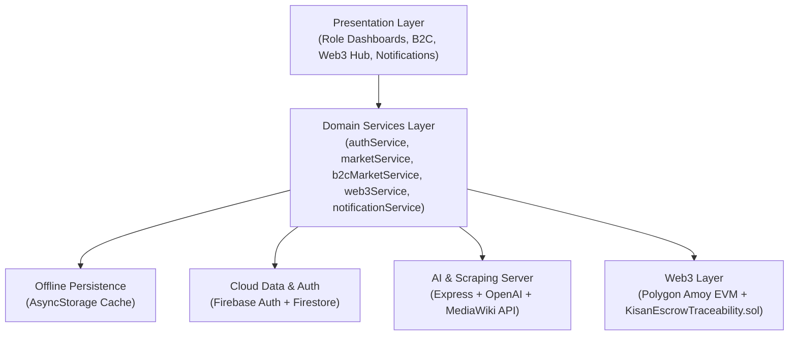

# KisanSAATHI — Software Development Life Cycle (SDLC) Specification

## 1. Phase 1: Planning & Feasibility
- **Project Name:** KisanSAATHI (Your Digital Krishi Officer)
- **Domain:** Agritech, Mandi Market Intelligence, Direct B2C Commerce, and Web3 Supply-Chain Traceability.
- **Target Personas:**
  1. **Farmer:** Needs real-time weather/spraying advisories, live APMC mandi prices, AI agronomy support, and direct B2C selling tools.
  2. **Customer / Buyer:** Needs direct access to verified farm produce in small (25kg, 50kg, 100kg) or wholesale lots with transparent pricing and escrow protection.
  3. **Mandi Owner / APMC Trader:** Needs daily arrival logging, rate board broadcasting, and trade inquiry management.

---

## 2. Phase 2: Requirements Analysis

### Functional Requirements (FR)
- **FR-01 Role-Based Access Control (RBAC):** Secure authentication and isolated dashboards per user role (`farmer`, `customer`, `mandi_owner`).
- **FR-02 Weather & Agronomic Advisory:** Real-time GPS/Nominatim geocoding, spraying risk checks, and soil/crop irrigation guidance.
- **FR-03 Live Mandi Intelligence:** Pan-India APMC rates, "Best Price" sorting, freight deduction net-profit calculator, and 2026 MSP benchmarks.
- **FR-04 Krishi Sahayak AI & Live Wikipedia Scanner:** Multimodal text/voice/image assistant grounded to 2026 rates with real-time Wikimedia API extraction.
- **FR-05 Kisan Direct (B2C) & 1-on-1 Chat:** Retail lot listings (25kg/50kg/100kg), negotiation chat with quick chips, and deal confirmation.
- **FR-06 Real-Time Notification Center:** Actionable alerts for mandi surges, weather risks, B2C inquiries, and PM-Kisan updates.
- **FR-07 Web3 Traceability & Smart Escrow:** Deterministic Agri-Wallet connection, immutable on-chain crop passports, and smart contract escrow (`KisanEscrowTraceability.sol`).

### Non-Functional Requirements (NFR)
- **NFR-01 Offline Resilience:** Local caching via AsyncStorage ensures core market, notification, and Web3 ledger data remain readable in low-connectivity rural areas.
- **NFR-02 Multilingual Accessibility:** Support for Hindi, English, and 22 Indian Scheduled Languages.
- **NFR-03 Security & Privacy:** No raw passwords stored in client state; secrets isolated in `.env`; Firebase Auth + Firestore Security Rules enforced.

---

## 3. Phase 3: System Architecture & Design

---

## 4. Phase 4: Implementation Standards
- Modular service separation under `services/`.
- Role-isolated screens under `screens/auth/`, `screens/customer/`, `screens/mandi/`, `screens/b2c/`, `screens/web3/`, and `screens/admin/`.
- Zero artificial emojis; consistent vector iconography via `MaterialCommunityIcons`.
- Solidity `^0.8.20` smart contract under `contracts/KisanEscrowTraceability.sol`.

---

## 5. Phase 5: Testing & Quality Assurance (QA)
- **Syntax & AST Verification:** Automated Babel AST transformation (`babel-preset-expo`) across all screens and entry points.
- **Unit & Integration Tests:** Executed via Node's native test runner (`npm test` -> `tests/runTests.js`) covering Web3 hashing, wallet generation, escrow state transitions, notification payloads, and B2C farmer-reply logic.
- **End-to-End UI Verification:** Automated headless browser inspection across web routes.

---

## 6. Phase 6: Deployment & Maintenance (CI/CD)
- Automated Continuous Integration via `.github/workflows/ci.yml` running `npm run lint:syntax` and `npm test` on every push/pull request.
- Environment configuration documented in `.env.example`.
